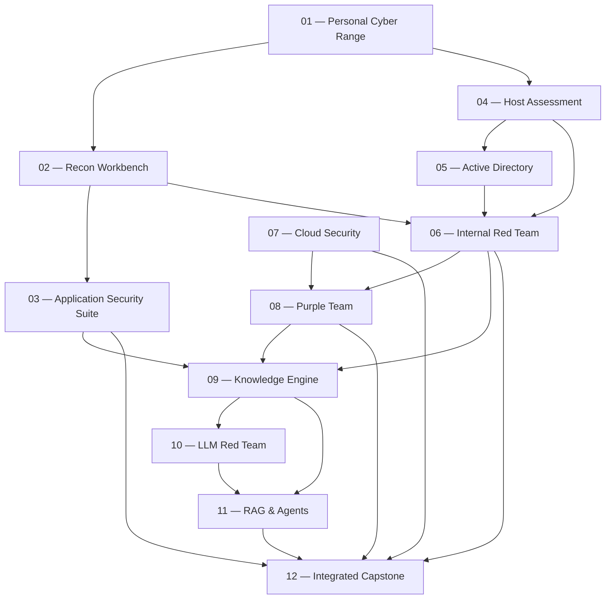

# YEAR 01 — 12-Project Security Engineering Flow

## Google AI Studio Build Specification + Personal Project Journal

**Purpose:** Build an interactive visual roadmap that shows the 12 flagship projects, their sub-projects, optional branches, and project dependencies. The user must be able to open any project or sub-project, record what was done, save progress, and return later without losing the record.

**Planning horizon:** One year  
**Project count:** Exactly 12 flagship projects  
**Primary specialization:** Offensive Security  
**Second priority:** AI Security Engineering  
**Third priority:** Cloud Security  
**Integrated practical lane:** Application Security (Web + API + Android Mobile)  
**Certification policy:** CPTS is deferred until after this project year. CJCA is not part of this plan.

---

# PART A — INSTRUCTIONS FOR GOOGLE AI STUDIO

## 1. Build request

Build a responsive, interactive web application named **YEAR 01 — Security Project Flow** using the project data in this document.

This is a personal roadmap and progress journal, not a generic project-management SaaS. Keep it focused. The main experience should be a visual flow of the 12 flagship projects. The user should be able to select a project, inspect its sub-projects, and write notes about what they personally completed.

Do not invent additional flagship projects, rename the 12 projects, remove sub-projects, or silently change their order. Optional projects must remain visibly separate from the core path.

## 2. Main user experience

### Main screen — Project Flow

Show the 12 flagship projects as a connected visual roadmap, grouped into four phases:

1. **Phase 01 — Operator Foundations:** Projects 01–03.
2. **Phase 02 — Enterprise Offensive Security:** Projects 04–06.
3. **Phase 03 — Cloud Security & Security Operations:** Projects 07–09.
4. **Phase 04 — AI Security Engineering:** Projects 10–12.

Each project card/node should display:

- Project number and full title.
- Short category label.
- Progress percentage based on completed **core** sub-projects only.
- Status: Not Started, In Progress, Blocked, or Completed.
- A small indicator showing whether the project has personal notes.
- A clear visual distinction between core work and optional work.

Connect the projects using the dependencies defined in Part D. The flow should remain readable on desktop and mobile. On narrow screens, use a vertical sequence or a compact scrollable flow rather than shrinking text until it becomes unreadable.

Selecting a project opens its detail view without losing the main roadmap context.

### Project detail view

Each flagship project must have:

1. Project title, number, phase, category, and purpose.
2. A visual tree/list of all core sub-projects.
3. A separate Optional Projects section, clearly marked optional.
4. A status selector for every core and optional sub-project.
5. A progress indicator calculated from core sub-projects only.
6. A project journal where the user can record what they did.
7. A short section showing upstream dependencies and downstream projects.

Selecting a sub-project should open its own detail area with:

- Sub-project title.
- Status.
- Date started and date completed (optional fields).
- **What I did** — a large editable text area.
- **What I learned** — editable text area.
- **Problems / blockers** — editable text area.
- **Evidence / links** — one or more URLs or text references (GitHub, screenshots, reports, lab notes, etc.).
- **Next step** — editable text area.
- Optional tags/tools used.

The user must be able to save multiple journal entries over time for the same project or sub-project. Each journal entry should have a created/updated date and support editing and deletion.

### Project-level journal

Every flagship project also needs a general journal, separate from its sub-project notes. This is for recording:

- Overall work completed.
- Major decisions and design changes.
- What worked and what failed.
- Lessons worth remembering.
- Links to the main GitHub repository, demo, report, or LinkedIn case study.
- Current next action.

Do not force the user to fill every field. Blank fields are valid.

## 3. Persistence and data safety

This requirement is critical.

- Automatically save changes in browser storage (localStorage or IndexedDB; choose the simpler reliable option for this app).
- Show a small **Saved** / **Saving** / **Unsaved changes** indicator.
- Preserve entries after refresh and browser restart on the same device/browser.
- Provide **Export Backup** to download all project statuses, sub-project statuses, journal entries, dates, tags, and links as a JSON file.
- Provide **Import Backup** to restore a previously exported JSON backup.
- Validate imported JSON and show a useful error if the file is invalid.
- Ask before replacing existing workspace data during import.
- Provide **Export Project Notes as Markdown** for an individual flagship project.
- Provide **Export All Notes as Markdown** for a readable archive of the full roadmap and journal.
- Do not claim that local browser storage syncs across devices. Explain in the UI that JSON backup is needed for moving data or protecting against browser-data loss.
- Never send journal contents to an external service. The app should work locally after it has loaded.

## 4. Progress rules

Use these rules consistently:

- Core sub-project statuses: `Not Started`, `In Progress`, `Blocked`, `Completed`.
- Optional sub-project statuses: `Not Started`, `In Progress`, `Blocked`, `Completed`, `Skipped`.
- A project's percentage = completed core sub-projects / total core sub-projects × 100.
- Optional sub-projects do not change the core percentage.
- A flagship project is `Completed` only when all its core sub-projects are `Completed`.
- If any core sub-project is `Blocked`, project status may show `Blocked` unless the user explicitly changes it; do not overwrite the user's manual status without warning.
- The overall roadmap percentage should be calculated from all core sub-projects across the 12 projects. Do not count optional items.
- Do not assign artificial points or weighted scores.

## 5. Visual design

Use a restrained dark interface:

- Near-black / charcoal background.
- Deep blue as the primary accent.
- Muted neutral text and borders.
- Clear typography and strong visual hierarchy.
- Minimal decoration; no neon cyberpunk effects, excessive glow, or unnecessary animations.
- Core projects should be visually prominent; optional branches should be lighter and labeled `OPTIONAL`.
- Use simple icons only when they improve scanning.
- Make the visual flow the main focus, not a dashboard full of charts.

## 6. Navigation

Keep navigation simple:

- **Roadmap** — main 12-project flow.
- **Journal** — searchable list of saved journal entries.
- **Backup & Export** — JSON backup and Markdown exports.

Useful filters:

- Phase.
- Specialization/category.
- Status.
- Core / Optional.

Search should find project names, sub-project names, and journal text.

## 7. Technical implementation expectations

- Build a working front end, not a static mockup.
- Use a simple maintainable component structure.
- Keep the roadmap data separate from UI components.
- Use stable IDs for all projects and sub-projects so saved notes remain attached to the correct item even if the UI is redesigned.
- Include empty states for projects with no notes.
- Include confirmation before deleting a journal entry.
- Include a clear way to return from project details to the roadmap.
- Use accessible labels and keyboard-friendly controls.
- Do not require a backend, login, paid API, or database service for the first version.
- Do not build team collaboration, user accounts, analytics dashboards, AI chat, or unrelated features.

## 8. Acceptance checklist for the generated app

The app is not complete until all of these work:

- [ ] Displays exactly 12 flagship projects.
- [ ] Groups projects into the four specified phases.
- [ ] Displays each project's full core sub-project list.
- [ ] Displays optional projects separately.
- [ ] Shows project dependencies.
- [ ] Allows status updates at project and sub-project level.
- [ ] Calculates progress from core sub-projects only.
- [ ] Allows project-level journal entries.
- [ ] Allows sub-project-level journal entries.
- [ ] Saves data after refresh.
- [ ] Exports a complete JSON backup.
- [ ] Imports a JSON backup safely.
- [ ] Exports one project's notes to Markdown.
- [ ] Exports all notes to Markdown.
- [ ] Supports search and filters.
- [ ] Works on desktop and mobile.
- [ ] Does not send personal notes to external services.

---

# PART B — THE 12 FLAGSHIP PROJECTS

## PHASE 01 — OPERATOR FOUNDATIONS

### 01 — Personal Cyber Range

**ID:** `P01`  
**Repository suggestion:** `operator-lab`  
**Category:** Shared Offensive Foundations  
**Purpose:** A reproducible, isolated environment for networking, operating systems, scripting, and security experiments.

**Core sub-projects**

- `P01-01` — Network Infrastructure Lab
- `P01-02` — Linux Operating System Lab
- `P01-03` — Windows Operating System Lab
- `P01-04` — Network Traffic Analysis Lab
- `P01-05` — Programming & Automation Toolkit
- `P01-06` — Virtualization & Container Lab
- `P01-07` — Git & Lab Documentation System

**Optional sub-projects**

- `P01-O01` — Firewall & Network Segmentation Lab
- `P01-O02` — Wireless Security Lab
- `P01-O03` — IPv6 Security Lab

**Primary specialization links:** Offensive Security; shared foundation for AI Security and Cloud Security.

### 02 — Reconnaissance & Enumeration Workbench

**ID:** `P02`  
**Repository suggestion:** `scope-recon`  
**Category:** Offensive Security / Security Automation  
**Purpose:** A scoped reconnaissance and enumeration workbench that turns observations into structured, reproducible asset information.

**Core sub-projects**

- `P02-01` — Scope & Authorization Manager
- `P02-02` — OSINT & Passive Recon Engine
- `P02-03` — DNS & Subdomain Enumeration
- `P02-04` — Asset Discovery & Inventory
- `P02-05` — Port & Service Enumeration
- `P02-06` — Technology Fingerprinting
- `P02-07` — Network & Attack Surface Mapping
- `P02-08` — Evidence Collection System
- `P02-09` — JSON / HTML Report Generator
- `P02-10` — Scope Enforcement Test Suite

**Optional sub-projects**

- `P02-O01` — Threat Intelligence Enrichment
- `P02-O02` — Continuous Attack Surface Monitoring
- `P02-O03` — Visual Asset Discovery Dashboard

**Primary specialization links:** Offensive Security; Cloud Security asset inventory; input to later Red Team engagements.

### 03 — Web, API & Mobile Application Security Suite

**ID:** `P03`  
**Repository suggestion:** `application-security-suite`  
**Category:** Application Security / Freelance Services  
**Purpose:** A unified application-security portfolio covering Web Applications, APIs, and Android applications, with engineering and client-delivery components.

**Core sub-projects**

**A. Web Application Security**

- `P03-01` — Authentication & Session Testing
- `P03-02` — Access Control & IDOR Testing
- `P03-03` — Injection & Input Validation Testing
- `P03-04` — Business Logic Security Testing
- `P03-05` — File Handling & SSRF Assessment
- `P03-06` — Source Code Review

**B. API Security**

- `P03-07` — REST API Security Assessment
- `P03-08` — JWT & OAuth Security
- `P03-09` — BOLA / BFLA Testing
- `P03-10` — Rate Limiting & Abuse Testing
- `P03-11` — GraphQL & WebSocket Security

**C. Android Application Security**

- `P03-12` — Android APK & Manifest Analysis
- `P03-13` — Local Storage & Data Leakage Testing
- `P03-14` — Authentication & Session Security
- `P03-15` — Network & TLS Testing
- `P03-16` — Deep Links, IPC & WebView Security
- `P03-17` — Static & Dynamic Analysis

**D. Application Security Engineering**

- `P03-18` — Application Threat Modeling
- `P03-19` — Secure Code Review Workflow
- `P03-20` — SAST / DAST / SCA Integration
- `P03-21` — CI/CD Security Testing
- `P03-22` — Security Regression Test Suite

**E. Client Assessment Package**

- `P03-23` — Scope & Rules of Engagement Templates
- `P03-24` — Technical Assessment Report Template
- `P03-25` — Executive Summary Template
- `P03-26` — Remediation & Retesting Package
- `P03-27` — Client Handover Package

**Optional sub-projects**

- `P03-O01` — iOS Application Security
- `P03-O02` — Advanced Android Instrumentation
- `P03-O03` — Advanced API Business Logic Assessment

**Primary specialization links:** Application Security, Web/API/Mobile Freelancing, and the application layer of AI systems.

---

## PHASE 02 — ENTERPRISE OFFENSIVE SECURITY

### 04 — Linux & Windows Host Security Assessment Framework

**ID:** `P04`  
**Repository suggestion:** `host-assessment-framework`  
**Category:** Infrastructure Security / Host Assessment  
**Purpose:** Assess operating-system configuration, local security boundaries, privilege exposure, host telemetry, and hardening.

**Core sub-projects**

**A. Linux Security Assessment**

- `P04-01` — Users, Groups & Permissions Assessment
- `P04-02` — Processes & Services Assessment
- `P04-03` — Sudo, SUID & Capabilities Assessment
- `P04-04` — Linux Privilege Assessment

**B. Windows Security Assessment**

- `P04-05` — Windows Permissions & Access Tokens
- `P04-06` — Services, Registry & Scheduled Tasks
- `P04-07` — Windows Privilege Assessment
- `P04-08` — PowerShell Assessment

**C. Enumeration & Evidence Engine**

- `P04-09` — System Information Collector
- `P04-10` — Credential & Secret Exposure Assessment
- `P04-11` — Process & Service Collection
- `P04-12` — Log & Event Collection

**D. Hardening & Validation**

- `P04-13` — Linux Hardening Baseline
- `P04-14` — Windows Hardening Baseline
- `P04-15` — Configuration Validation
- `P04-16` — Remediation & Retest

**Optional sub-projects**

- `P04-O01` — Windows Internals & Forensics
- `P04-O02` — Advanced Linux Internals

**Primary specialization links:** Offensive Security, host security assessment, and Detection Engineering.

### 05 — Active Directory & Enterprise Identity Security

**ID:** `P05`  
**Repository suggestion:** `ad-enterprise-lab`  
**Category:** Enterprise Identity / Offensive Security  
**Purpose:** A reproducible enterprise identity environment for assessing trust relationships, permissions, authentication, and attack paths.

**Core sub-projects**

- `P05-01` — Enterprise Domain Infrastructure
- `P05-02` — Users, Groups & Organizational Units
- `P05-03` — DNS, Group Policy & Domain Configuration
- `P05-04` — Domain & Forest Relationships
- `P05-05` — Kerberos Authentication Assessment
- `P05-06` — NTLM Authentication Assessment
- `P05-07` — LDAP & SPN Analysis
- `P05-08` — Service Accounts & Delegation Assessment
- `P05-09` — Active Directory Enumeration
- `P05-10` — ACL & Permission Analysis
- `P05-11` — BloodHound Data & Attack Path Analysis
- `P05-12` — Credential Exposure Assessment
- `P05-13` — Misconfiguration & Privilege Path Assessment
- `P05-14` — Identity Hardening & Remediation
- `P05-15` — Retesting & Identity Security Report

**Optional sub-projects**

- `P05-O01` — Active Directory Certificate Services Assessment
- `P05-O02` — Entra ID & Hybrid Identity
- `P05-O03` — Domain Trust Assessment

**Primary specialization links:** Offensive Security, Enterprise Security, Cloud Identity, and the identity foundations used by AI agents.

### 06 — Full Internal Red Team Engagement

**ID:** `P06`  
**Repository suggestion:** `red-team-engagement-01`  
**Category:** Offensive Security / Engagement Operations  
**Purpose:** Integrate reconnaissance, host assessment, identity assessment, controlled attack-path validation, detection review, and professional reporting in one authorized engagement.

**Core sub-projects**

- `P06-01` — Engagement Planning & Rules of Engagement
- `P06-02` — Internal Reconnaissance
- `P06-03` — Internal Attack Surface Mapping
- `P06-04` — Initial Access Simulation
- `P06-05` — Host & Identity Assessment
- `P06-06` — Privilege & Credential Path Assessment
- `P06-07` — Lateral Movement Simulation
- `P06-08` — Controlled Objective Validation
- `P06-09` — MITRE ATT&CK Mapping
- `P06-10` — Detection & Telemetry Review
- `P06-11` — Evidence Package & Attack Timeline
- `P06-12` — Technical Report & Executive Summary
- `P06-13` — Remediation, Retest & Cleanup
- `P06-14` — Engagement Debrief & Handover

**Optional sub-projects**

- `P06-O01` — Multi-Domain Enterprise Campaign
- `P06-O02` — Hybrid Identity Engagement
- `P06-O03` — Advanced Adversary Infrastructure Lab

**Primary specialization links:** Offensive Security; consumes work from Projects 02, 04, and 05; feeds Project 08 and Project 12.

---

## PHASE 03 — CLOUD SECURITY & SECURITY OPERATIONS

### 07 — Cloud Security Assessment & Hardening Platform

**ID:** `P07`  
**Repository suggestion:** `cloud-security-platform`  
**Category:** Cloud Security  
**Primary cloud:** AWS  
**Purpose:** Assess and harden cloud identity, network boundaries, data stores, workloads, containers, and monitoring.

**Core sub-projects**

- `P07-01` — Cloud Architecture & Asset Inventory
- `P07-02` — AWS Environment Architecture
- `P07-03` — IAM Users, Roles & Policies Assessment
- `P07-04` — Least Privilege & Identity Attack Paths
- `P07-05` — VPC & Subnet Security
- `P07-06` — Security Groups, Routing & Segmentation
- `P07-07` — S3 & Storage Permissions Assessment
- `P07-08` — Secrets & Sensitive Data Protection
- `P07-09` — Docker & Container Security
- `P07-10` — Kubernetes Security Fundamentals
- `P07-11` — CloudTrail, Logging & Monitoring
- `P07-12` — Cloud Incident Readiness
- `P07-13` — Infrastructure as Code Security
- `P07-14` — Policy as Code & Configuration Validation
- `P07-15` — Cloud Hardening, Remediation & Retesting

**Optional sub-projects**

- `P07-O01` — Azure Security Assessment
- `P07-O02` — Advanced Kubernetes Security
- `P07-O03` — Serverless Security
- `P07-O04` — Multi-Cloud Security

**Primary specialization links:** Cloud Security; cloud environment for AI applications and agents; Project 12 integration.

### 08 — Detection Engineering & Purple Team Validation

**ID:** `P08`  
**Repository suggestion:** `purple-team-validation-platform`  
**Category:** Detection Engineering / Defensive Validation  
**Purpose:** Validate what security controls observe, detect, and miss during controlled security testing.

**Core sub-projects**

- `P08-01` — Telemetry Collection Architecture
- `P08-02` — Windows Event Logs & Sysmon
- `P08-03` — Linux Audit & System Logs
- `P08-04` — Cloud Telemetry Integration
- `P08-05` — MITRE ATT&CK Mapping
- `P08-06` — Atomic Test Library
- `P08-07` — Controlled Adversary Emulation Scenarios
- `P08-08` — Detection Use Cases
- `P08-09` — Sigma Rule Development
- `P08-10` — Alert Logic & Validation
- `P08-11` — False Positive / False Negative Analysis
- `P08-12` — Incident Investigation Simulation
- `P08-13` — Response Playbooks
- `P08-14` — Detection Coverage Matrix
- `P08-15` — Detection Regression & Purple Team Report

**Optional sub-projects**

- `P08-O01` — SIEM Integration
- `P08-O02` — Threat Hunting
- `P08-O03` — Advanced Endpoint Forensics

**Primary specialization links:** Offensive Security, Security Operations, Cloud Security, and AI security monitoring.

### 09 — Open Pentest Knowledge Engine

**ID:** `P09`  
**Repository suggestion:** `pentest-knowledge-engine`  
**Category:** AI Engineering Foundation / Security Knowledge Product  
**Purpose:** Build an openly documented, traceable, searchable security knowledge system that can later support RAG and controlled agents.

**Core sub-projects**

- `P09-01` — Source Collection & Registry
- `P09-02` — Official Documentation & Standards Corpus
- `P09-03` — Research Papers & Vulnerability Advisories Corpus
- `P09-04` — Personal Lab Notes & Writeups Corpus
- `P09-05` — License & Provenance Registry
- `P09-06` — Document Ingestion Pipeline
- `P09-07` — Normalization & Deduplication Pipeline
- `P09-08` — Security Knowledge Taxonomy
- `P09-09` — Metadata Extraction & Classification
- `P09-10` — Chunking & Embeddings
- `P09-11` — Vector Search & Retrieval
- `P09-12` — RAG Retrieval & Source Citations
- `P09-13` — Retrieval Evaluation Dataset
- `P09-14` — Answer Grounding & Attribution Tests
- `P09-15` — Search Interface & Knowledge API

**Optional sub-projects**

- `P09-O01` — Fine-Tuning / LoRA Experiments
- `P09-O02` — Security Finding Classification Model
- `P09-O03` — Knowledge Contribution Portal

**Primary specialization links:** AI Security Engineering foundation; receives knowledge from Projects 02, 03, 04, 05, 06, and 08; feeds Projects 10 and 11.

---

## PHASE 04 — AI SECURITY ENGINEERING

### 10 — LLM Application Red Teaming & Evaluation Platform

**ID:** `P10`  
**Repository suggestion:** `llm-red-team-platform`  
**Category:** AI Security Engineering / LLM Red Teaming  
**Purpose:** Build and assess an LLM-powered application using repeatable security tests, evidence, evaluation, and remediation.

**Core sub-projects**

- `P10-01` — LLM Application Environment
- `P10-02` — Model Endpoint & Backend API Integration
- `P10-03` — Session & Context Management
- `P10-04` — Synthetic Data & Logging Environment
- `P10-05` — AI System Threat Model
- `P10-06` — Data Flow & Trust Boundary Map
- `P10-07` — Direct Prompt Injection Testing
- `P10-08` — Indirect Prompt Injection Testing
- `P10-09` — Jailbreak Robustness Evaluation
- `P10-10` — Sensitive Data Disclosure Testing
- `P10-11` — System Prompt & Configuration Exposure Testing
- `P10-12` — Unsafe Output Handling Assessment
- `P10-13` — Cross-Session Isolation Testing
- `P10-14` — Model & API Abuse Assessment
- `P10-15` — Automated Evaluation Harness
- `P10-16` — Scoring & Human Review Workflow
- `P10-17` — Evidence Capture & Regression Testing
- `P10-18` — AI Defense, Remediation & Retesting

**Optional sub-projects**

- `P10-O01` — Multimodal AI Security Testing
- `P10-O02` — Model Privacy Assessment
- `P10-O03` — Adversarial Machine Learning Experiments

**Primary specialization links:** AI Security Engineering; builds on Project 09; feeds Project 11 and Project 12.

### 11 — RAG, AI Agents & MCP Security

**ID:** `P11`  
**Repository suggestion:** `controlled-agent-security-platform`  
**Category:** AI Security Engineering / Agent Security  
**Purpose:** Assess and engineer the security of retrieval systems, agents, tools, permissions, and controlled execution.

**Core sub-projects**

**A. RAG Security Assessment**

- `P11-01` — Document Ingestion Security
- `P11-02` — Chunking & Embedding Integrity
- `P11-03` — Retrieval Access Control
- `P11-04` — Tenant Isolation
- `P11-05` — Indirect Prompt Injection Through Documents
- `P11-06` — Knowledge Base Poisoning Assessment
- `P11-07` — Source Attribution & Retrieval Regression

**B. AI Agent Architecture**

- `P11-08` — Mission Planner
- `P11-09` — Knowledge Agent
- `P11-10` — Analysis Agent
- `P11-11` — Validation Agent
- `P11-12` — Evidence Agent
- `P11-13` — Report Agent
- `P11-14` — Agent Orchestrator

**C. Tool & MCP Security**

- `P11-15` — Tool Registry
- `P11-16` — MCP Server & Client Security
- `P11-17` — Tool Input Validation
- `P11-18` — Tool Permission Boundaries

**D. Agent Authorization & Isolation**

- `P11-19` — Scope & Policy Guard
- `P11-20` — Sandboxed Execution
- `P11-21` — Human Approval Workflow
- `P11-22` — Identity & Secret Isolation
- `P11-23` — Network Egress Controls

**E. Agent Security Evaluation**

- `P11-24` — Agent Prompt Injection Tests
- `P11-25` — Unauthorized Tool Use Tests
- `P11-26` — Audit Trail & Action Traceability
- `P11-27` — Agent Security Regression Tests

**Optional sub-projects**

- `P11-O01` — AI Browser Agent Security
- `P11-O02` — AI Coding Agent Security
- `P11-O03` — Multi-Agent Collaboration Security

**Primary specialization links:** AI Security Engineering; consumes Project 09 knowledge and Project 10 evaluation methods; feeds Project 12.

### 12 — Integrated Enterprise & AI Red Team Capstone

**ID:** `P12`  
**Repository suggestion:** `integrated-red-team-capstone`  
**Category:** Integrated Security Engagement / Final Portfolio  
**Purpose:** Demonstrate an end-to-end, evidence-based traditional enterprise security engagement and an AI security engagement, with engineering validation and professional release artifacts.

**Core sub-projects**

**A. Traditional Enterprise Engagement**

- `P12-01` — Network & Infrastructure Assessment
- `P12-02` — Web / API / Android Assessment
- `P12-03` — Linux & Windows Host Assessment
- `P12-04` — Active Directory Assessment
- `P12-05` — Cloud Environment Assessment
- `P12-06` — Detection & Purple Team Validation

**B. AI Red Team Engagement**

- `P12-07` — LLM Application Assessment
- `P12-08` — RAG Knowledge Engine Assessment
- `P12-09` — AI Agent Assessment
- `P12-10` — MCP & Tool Security Assessment
- `P12-11` — AI Evaluation & Regression Assessment

**C. Security Engineering Validation**

- `P12-12` — Integrated Threat Model
- `P12-13` — Scope & Policy Enforcement Validation
- `P12-14` — Evidence Quality & Technical QA
- `P12-15` — Remediation & Retesting
- `P12-16` — Technical & Executive Reporting

**D. Final Portfolio & Product Release**

- `P12-17` — Pentest Knowledge Engine v1 Release
- `P12-18` — Controlled Red Team Agent System v1 Release
- `P12-19` — Enterprise Engagement Case Study
- `P12-20` — AI Red Team Case Study
- `P12-21` — GitHub Releases & Portfolio Publication

**Optional sub-projects**

- `P12-O01` — Independent External Lab Assessment
- `P12-O02` — Open-Source Security Contribution
- `P12-O03` — Authorized Freelance Engagement
- `P12-O04` — Research Publication

**Primary specialization links:** All three specializations; integrates Application Security and the enterprise and AI projects.

---

# PART C — SHARED PROJECT JOURNAL TEMPLATE

The application should offer this template for both flagship projects and individual sub-projects. All fields are optional except the entry title.

```yaml
entry_id: generated-stable-id
entry_title: ""
created_at: ""
updated_at: ""
work_date: ""
what_i_did: ""
what_i_learned: ""
problems_and_blockers: ""
solutions_or_decisions: ""
tools_and_technologies: []
evidence_links: []
next_step: ""
tags: []
```

Suggested entry title examples:

- `First implementation`
- `Manual test results`
- `Debugging notes`
- `Design decision`
- `Retest results`
- `Weekly progress`

The user should be able to add as many entries as needed. Do not overwrite an older journal entry when a new one is added.

## Project-level fields

```yaml
project_id: P01
status: Not Started
progress: calculated
repository_url: ""
demo_url: ""
report_url: ""
linkedin_url: ""
project_summary: ""
current_focus: ""
project_journal: []
```

## Sub-project fields

```yaml
subproject_id: P01-01
status: Not Started
started_at: ""
completed_at: ""
journal_entries: []
```

---

# PART D — PROJECT DEPENDENCIES

Represent these as directional links in the roadmap. They show useful dependencies and reuse; they do not mean a project can never be explored earlier.



## Project reuse map

- Project 01 provides the lab and shared foundations used by Projects 02 and 04.
- Project 02 provides scoped asset discovery and evidence patterns used by Projects 03 and 06.
- Project 03 provides application assessment knowledge, case-study material, and client-delivery templates used again in Project 12.
- Project 04 provides host assessment methods used in Projects 05, 06, and 12.
- Project 05 provides enterprise identity assessment used in Projects 06 and 12.
- Project 06 provides engagement methodology, evidence, and attack narratives that feed Projects 08, 09, and 12.
- Project 07 provides cloud assessment and cloud telemetry that feed Projects 08 and 12.
- Project 08 provides detection test cases and coverage evidence for Project 12, and structured security material for Project 09.
- Project 09 provides traceable security knowledge for Projects 10 and 11.
- Project 10 provides LLM evaluation methods used by Project 11 and Project 12.
- Project 11 provides controlled agent security capabilities used in Project 12.
- Project 12 integrates the previous work and publishes the final case studies and product releases.

---

# PART E — GLOBAL TRACKS / TAGS

Use these as labels and filters. A sub-project may have more than one tag.

- `OFFENSIVE_SECURITY`
- `AI_SECURITY_ENGINEERING`
- `CLOUD_SECURITY`
- `APPLICATION_SECURITY`
- `WEB_SECURITY`
- `API_SECURITY`
- `MOBILE_SECURITY`
- `NETWORK_SECURITY`
- `LINUX`
- `WINDOWS`
- `ACTIVE_DIRECTORY`
- `RECONNAISSANCE`
- `EXPLOITATION_ANALYSIS`
- `IDENTITY_SECURITY`
- `DETECTION_ENGINEERING`
- `PURPLE_TEAM`
- `LLM_SECURITY`
- `RAG_SECURITY`
- `AGENT_SECURITY`
- `MCP_SECURITY`
- `AUTOMATION`
- `REPORTING`
- `FREELANCING`
- `OPTIONAL`

---

# PART F — DATA AND CONTENT RULES

1. The 12 flagship projects and their IDs are fixed. Do not create a thirteenth flagship project.
2. Keep optional sub-projects separate and excluded from the core progress calculation.
3. Do not create fake progress, completion dates, notes, or evidence. A new workspace starts empty.
4. The app must let the user rename or edit their personal notes, but the canonical roadmap titles and IDs should remain stable by default.
5. If the user edits a roadmap label, preserve the underlying stable ID so existing journal entries remain linked correctly.
6. Do not auto-mark a project complete merely because a sub-project has notes. Completion is a deliberate status change based on the user's own assessment.
7. Do not treat a GitHub URL or LinkedIn post as proof that a technical project is complete. These are publication links, not completion evidence by themselves.
8. Preserve dates, links, and user-entered text exactly when exporting and importing.
9. Provide a warning before destructive actions such as deleting a journal entry, clearing the workspace, or replacing data from a backup.
10. Keep the first version local-first and simple. A future cloud-sync feature can be added separately, but it is not required here.

---

# PART G — FIRST-RUN EMPTY STATE

When the user opens the app for the first time:

- Show all 12 flagship projects with `Not Started` status.
- Show 0% overall progress.
- Show no journal entries.
- Include a short note: `Your roadmap is ready. Open a project to record your first activity. Your changes are saved in this browser. Export a JSON backup regularly to protect your notes or move them to another device.`
- Do not prefill sample accomplishments or fake dates.

**End of specification.**
